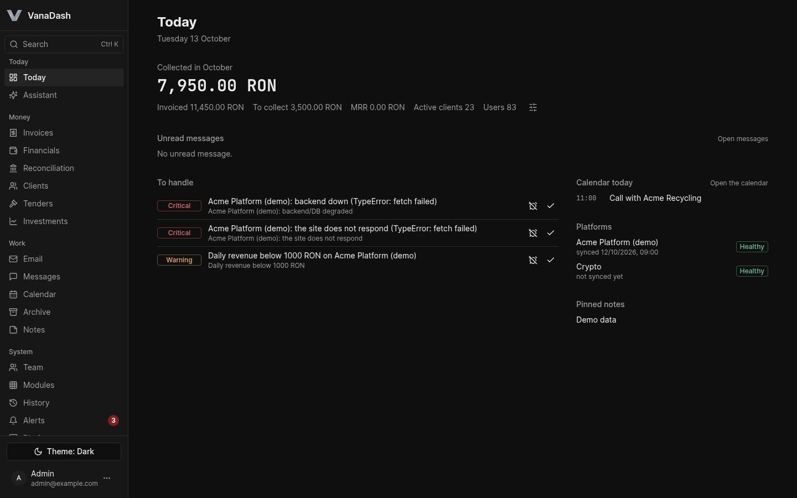

# VanaDash

The internal back office of [Vanadium Systems](https://vanadium.systems), a one-person software
company in Romania: invoicing, bank reconciliation, email, team chat, calendar, CRM and server
monitoring in a single app, on a single small VPS. It runs in production every day.

The source is public so you can read it, run it and send changes. It is **source-available, not
open source**: see [License](#license).



## What's inside

| Module | What it does | Scope |
|---|---|---|
| Invoices | Issues and numbers invoices, renders PDF and UBL XML, tracks payment | Romania-specific |
| e-Factura / SPV | Sends issued invoices to ANAF, pulls received ones, reads SPV messages | Romania-specific |
| Declarations | Builds the D301 and D390 VAT declarations and a quarterly package | Romania-specific |
| Contracts | Editable contract templates, addenda, digital signature placement | Romanian contract text |
| Reconciliation | Imports bank transactions (Revolut Business) and matches them to invoices | Country-neutral |
| Financials | Profit and loss, cash flow, monthly reports; EUR/USD rates from the BNR | BNR feed is Romania-specific |
| Clients | Prospect list with scoring, a price calculator, promotion to client | Country-neutral |
| Tenders | Watches the Romanian public procurement portal (SICAP) for matching notices | Romania-specific |
| Email | Shared mailboxes, threads, templates, bulk sends, drip sequences | Country-neutral |
| Messages | Direct and group chat in real time, attachments, presence | Country-neutral |
| Calendar | Per-person calendars, sharing, common events, public booking | Country-neutral |
| Archive | Per-person file spaces on object storage, folder sharing | Country-neutral |
| Notes, Plan, Wishlist | Personal notes and goals | Country-neutral |
| Platforms, Alerts | Pulls KPIs from other products through connectors; threshold alerts | Country-neutral |
| Team, Modules, History | Invitations, roles, a feature catalog switched on per role, audit log | Country-neutral |
| Support, Guides, Updates | Tickets to the operator, per-page guides, release notes | Country-neutral |
| Assistant | An in-app assistant that can read what the user can read | Country-neutral |

There is also a thin Android shell (Capacitor) that loads the web app and receives push
notifications.

## Why it is built this way

Everything follows from three facts: one developer, one VPS with 1 vCPU and 2 GB of RAM, one
company registered in Romania.

So there is one process and one database: Fastify, Drizzle and PostgreSQL, a React SPA, Docker
Compose. No queue, no cache server, no microservices. Chat runs over server-sent events with an
in-memory bus, which is enough for one container. Aggregation happens in SQL, not in JavaScript
over large arrays.

Romania comes first because that is where the invoices are. e-Factura is mandatory here, so the
ANAF connector, the UBL builder and the VAT declarations came early and are thorough. The app
exists because of them.

Connectors keep the country-specific parts at the edge. The tax authority, the bank and external
products each sit behind an interface in [`backend/src/connectors`](backend/src/connectors), and
nothing outside that folder knows which platform it is talking to.

Access is a catalog, checked at startup. Every route must resolve to exactly one feature in
[`features.ts`](backend/src/shared/lib/features.ts) or be declared `self`, `public` or `machine`.
A route that does not resolve stops the server from starting, and so does one registered without
authentication and not declared public. A new endpoint cannot ship unguarded by accident.

It serves a single company, so there is no tenant isolation. Roles and features decide what each
colleague sees.

## Adapting it to another country

The neutral modules work as they are. To use the money side elsewhere you would replace:

1. the accounting connector ([`connectors/anaf`](backend/src/connectors/anaf)) with your tax
   authority's e-invoicing API, or none;
2. the declaration builders (`connectors/anaf/declarations`);
3. the exchange-rate source ([`shared/lib/bnr.ts`](backend/src/shared/lib/bnr.ts));
4. the contract templates, which are Romanian legal text.

Start with [`docs/CONNECTOR_GUIDE.md`](docs/CONNECTOR_GUIDE.md). A connector for another country
is the most useful contribution this project can receive.

## Run it locally

You need Docker, Node 22+ and pnpm 9+.

```bash
git clone https://github.com/Vanadium-Systems/vana-dash.git
cd vana-dash
pnpm install
cp .env.example .env
```

Set the three required values in `.env`:

```bash
ADMIN_PASSWORD=          # at least 12 characters
JWT_SECRET=              # openssl rand -base64 48
MASTER_ENCRYPTION_KEY=   # openssl rand -hex 32
```

Then:

```bash
./dev start              # postgres, backend on :3001, frontend on :5174; migrates and seeds
./dev db seed:demo en    # optional: invented clients, invoices, prospects, messages (en or ro)
```

Open <http://localhost:5174> and sign in with `ADMIN_EMAIL` and `ADMIN_PASSWORD` from `.env`.
The first start takes a couple of minutes because the containers install their dependencies.

The demo seed also switches off the scheduled jobs that poll Romanian public sources (BNR
exchange rates, the SICAP procurement portal) and the bank. Without it they are on; turn them
off under Settings if you do not need them.

`./dev help` lists the other commands (`stop`, `logs`, `reset`, `db migrate`). Every integration
in `.env.example` is optional: left empty, that feature is off and the rest works.

The checks that must pass before a change is merged:

```bash
pnpm typecheck && pnpm lint && pnpm test && pnpm build
```

The backend tests run against the local PostgreSQL from `./dev start`.

## Status

In production since mid-2026, used daily by its author and a few colleagues.

- **The interface is in Romanian and English.** Each person picks a language and a display
  currency in My profile; `DEFAULT_LOCALE` sets what a new installation starts in. Invoices,
  declarations and contract templates stay in Romanian. Terms are in
  [docs/GLOSSARY.md](docs/GLOSSARY.md).
- Code comments are mostly in Romanian too. New code and all public documentation are written in
  English; older comments are translated as the files are touched.
- Not planned for now: multi-company hosting on one instance, video calls.

## License

VanaDash is licensed under the [PolyForm Noncommercial License 1.0.0](LICENSE.md). You may read,
run and modify it for personal use, study, research, and inside non-profit, educational or public
organisations. You may not use it commercially, which includes running it for a business or
selling it, without a separate licence from Vanadium Systems.

The name and logo are not covered by that licence: see [TRADEMARKS.md](TRADEMARKS.md).

## Want this for your company?

Tell me what you need. The app was shaped by one Romanian company's work, so for another company
or another country the first step is a conversation about your invoicing rules, your bank and the
tools you want to replace. A commercial licence, a hosted instance or custom work are all
possible; which one makes sense depends on that conversation.

Write to <contact@vanadium.systems>.

## Contributing and security

Read [CONTRIBUTING.md](CONTRIBUTING.md) before opening a pull request. Report vulnerabilities
privately, as described in [SECURITY.md](SECURITY.md).
