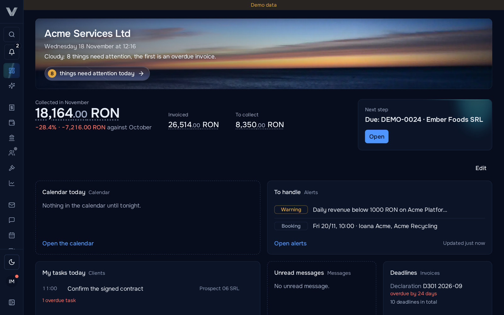
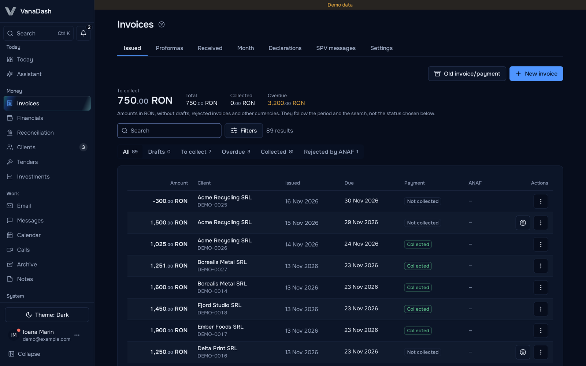
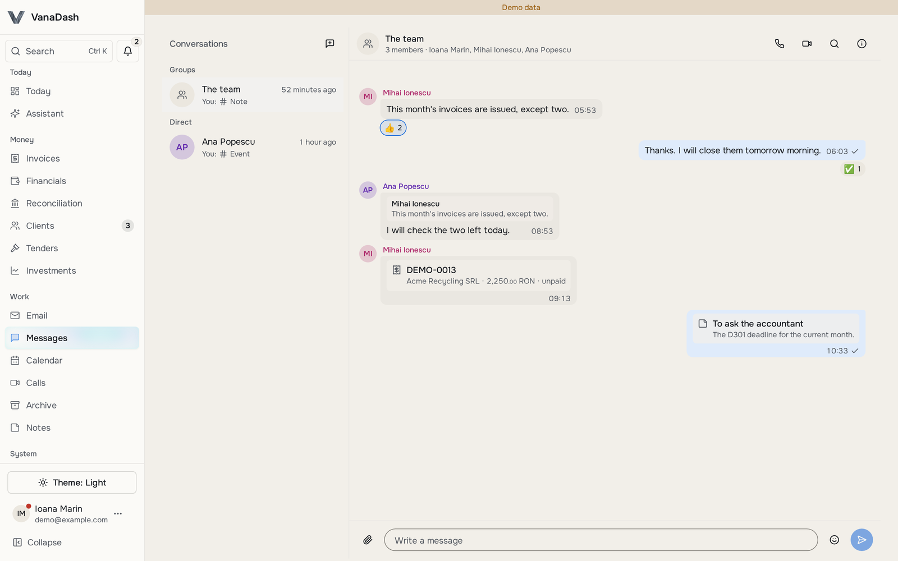

# VanaDash

VanaDash is the software [Vanadium Systems](https://vanadium.systems) built to run itself: invoicing,
bank reconciliation, email, encrypted team chat and calls, calendar, CRM and server monitoring in a
single app, on a single small VPS. We use it every day, on real invoices and real money.

The source is public as an example of how we work. It shows what we built for ourselves and the
standard we bring to software we build for other companies. If you are thinking of hiring us, read
the code first. It is **source-available, not open source**: see [License](#license).



## Where to look

- **Access control:** [`features.ts`](backend/src/shared/lib/features.ts) maps every route to one
  feature, and the server refuses to start if a route is left out.
- **Company isolation:** row-level security on every business table, tested on each CI run with the
  same restricted database role production uses ([`tenancy.ts`](backend/src/shared/lib/tenancy.ts)).
- **e-Invoicing:** the [ANAF connector](backend/src/connectors/anaf), with its UBL builder, VAT
  declarations and retries against a real government API.
- **Encrypted chat:** Olm and Megolm, cross-signing and key backup, with ciphertext only on the server.
- **Schema history:** every change as a SQL migration in
  [`backend/src/shared/db/migrations`](backend/src/shared/db/migrations).

## What's inside

| Module | What it does | Scope |
|---|---|---|
| Invoices | Issues and numbers invoices and proformas, handles credit notes, renders PDF and UBL XML, tracks payments | Romania-specific |
| e-Factura / SPV | Sends issued invoices to ANAF, pulls received ones, reads SPV messages | Romania-specific |
| Declarations | Builds the D301 and D390 VAT declarations, a monthly close checklist and a quarterly package | Romania-specific |
| Contracts | Editable contract templates, addenda, digital signature placement | Romanian contract text |
| Reconciliation | Imports bank transactions (Revolut Business) and matches them to invoices | Country-neutral |
| Financials | Profit and loss, cash flow, monthly reports; EUR/USD rates from the BNR | BNR feed is Romania-specific |
| Clients | Prospect list with scoring and team ownership, a price calculator, promotion to client | Country-neutral |
| Tenders | Watches the Romanian public procurement portal (SICAP) for matching notices | Romania-specific |
| Email | Shared mailboxes, threads, templates, bulk sends, drip sequences, separate SMTP mailboxes for outreach | Country-neutral |
| Messages | End-to-end encrypted direct and group chat in real time, attachments, presence | Country-neutral |
| Calls | End-to-end encrypted audio and video calls from Messages or by guest link, over LiveKit Cloud | Country-neutral |
| Calendar | Per-person calendars, sharing, common events, public booking | Country-neutral |
| Archive | Per-person file spaces on object storage, folder sharing | Country-neutral |
| Notes, Plan, Wishlist | Personal notes and goals | Country-neutral |
| Investments | Watchlists, portfolio and orders on your own exchange or broker account | Country-neutral |
| Platforms, Alerts | Pulls KPIs from other products through connectors; threshold alerts | Country-neutral |
| Team, Modules, History | Invitations, roles, a feature catalog switched on per role, audit log | Country-neutral |
| Support, Guides, Updates | Tickets to the operator, per-page guides, release notes | Country-neutral |
| Assistant | An in-app assistant that can read what the user can read, on Anthropic's API or a local model | Country-neutral |
| API tokens, MCP | Personal tokens for the API and an MCP endpoint for AI clients, limited by the person's role | Country-neutral |





There is also a thin Android shell (Capacitor) that loads the web app and receives push
notifications.

## Why it is built this way

Everything follows from three facts: one developer, one VPS with 1 vCPU and 2 GB of RAM, one
company registered in Romania.

So there is one process and one database: Fastify, Drizzle and PostgreSQL, a React SPA, Docker
Compose. No queue, no cache server, no microservices. Chat runs over server-sent events with an
in-memory bus, which is enough for one container. Aggregation happens in SQL, not in JavaScript
over large arrays.

Romania comes first because that is where the invoices are. e-Factura is mandatory here, so the
ANAF connector, the UBL builder and the VAT declarations came early and are thorough. The app
exists because of them.

Connectors keep the country-specific parts at the edge. The tax authority, the bank and external
products each sit behind an interface in [`backend/src/connectors`](backend/src/connectors), and
nothing outside that folder knows which platform it is talking to.

Access is a catalog, checked at startup. Every route must resolve to exactly one feature in
[`features.ts`](backend/src/shared/lib/features.ts) or be declared `self`, `public` or `machine`.
A route that does not resolve stops the server from starting, and so does one registered without
authentication and not declared public. A new endpoint cannot ship unguarded by accident.

Company data is separated in the database. It serves one company today, but business tables carry
a `tenant_id`, PostgreSQL row-level security enforces it in production, and each company has its
own encryption key. Inside a company, roles and features decide what each colleague sees.

Messages are encrypted on the sender's device with Olm and Megolm, so the server stores ciphertext
and search inside a conversation runs on the device. Calls are encrypted end to end as well.

## Adapting it to another country

The neutral modules work as they are. To use the money side elsewhere you would replace:

1. the accounting connector ([`connectors/anaf`](backend/src/connectors/anaf)) with your tax
   authority's e-invoicing API, or none;
2. the declaration builders (`connectors/anaf/declarations`);
3. the exchange-rate source ([`shared/lib/bnr.ts`](backend/src/shared/lib/bnr.ts));
4. the contract templates, which are Romanian legal text;
5. the country pack ([`backend/src/countries`](backend/src/countries)): time zone, currency,
   address rules, phone format, declaration deadlines and the company register lookup.

Start with [`docs/CONNECTOR_GUIDE.md`](docs/CONNECTOR_GUIDE.md). Pull requests are not accepted
for now (see [CONTRIBUTING.md](CONTRIBUTING.md)), but an issue saying which country you need helps.

## Run it locally

You need Docker, Node 22+ and pnpm 9+.

```bash
git clone https://github.com/Vanadium-Systems/vana-dash.git
cd vana-dash
pnpm install
cp .env.example .env
```

Set the three required values in `.env`:

```bash
ADMIN_PASSWORD=          # at least 12 characters
JWT_SECRET=              # openssl rand -base64 48
MASTER_ENCRYPTION_KEY=   # openssl rand -hex 32
```

Then:

```bash
./dev start              # postgres, backend on :3001, frontend on :5174; migrates and seeds
./dev db seed:demo en    # optional: invented clients, invoices, prospects, messages (en or ro)
```

Open <http://localhost:5174> and sign in with `ADMIN_EMAIL` and `ADMIN_PASSWORD` from `.env`.
The first start takes a couple of minutes because the containers install their dependencies.

The demo seed also switches off the scheduled jobs that poll Romanian public sources (BNR
exchange rates, the SICAP procurement portal) and the bank. Without it they are on; turn them
off under Settings if you do not need them.

`./dev help` lists the other commands (`stop`, `logs`, `reset`, `db migrate`). Every integration
in `.env.example` is optional: left empty, that feature is off and the rest works.

The checks that must pass before a change is merged:

```bash
pnpm typecheck && pnpm lint && pnpm test && pnpm build
```

The backend tests run against the local PostgreSQL from `./dev start`.

## Status

In production since mid-2026, used daily by its author and a few colleagues.

- **The interface is in Romanian and English.** Each person picks a language and a display
  currency in My profile; `DEFAULT_LOCALE` sets what a new installation starts in. Invoices,
  declarations and contract templates stay in Romanian. Terms are in
  [docs/GLOSSARY.md](docs/GLOSSARY.md).
- Code comments are mostly in Romanian too. New code and all public documentation are written in
  English; older comments are translated as the files are touched.
- Hosting other companies on one instance is built at the data level but not offered yet.
- Not planned for now: a hosted sign-up page. People join by invitation.

## License

VanaDash is licensed under the [PolyForm Noncommercial License 1.0.0](LICENSE.md). You may read,
run and modify it for personal use, study, research, and inside non-profit, educational or public
organisations. You may not use it commercially, which includes running it for a business or
selling it, without a separate licence from Vanadium Systems.

The name and logo are not covered by that licence: see [TRADEMARKS.md](TRADEMARKS.md).

## Want something like this for your company?

This is the kind of software we build. VanaDash was shaped by one Romanian company's work, and yours
will have its own rules, bank and tools, so the first step is a conversation about them. It can end
in custom software, a commercial licence or a hosted instance.

Write to <contact@vanadium.systems>.

## Contributing and security

Pull requests are not accepted for now; issues are. [CONTRIBUTING.md](CONTRIBUTING.md) says why
and how the code is kept. Report vulnerabilities privately, as described in
[SECURITY.md](SECURITY.md).
